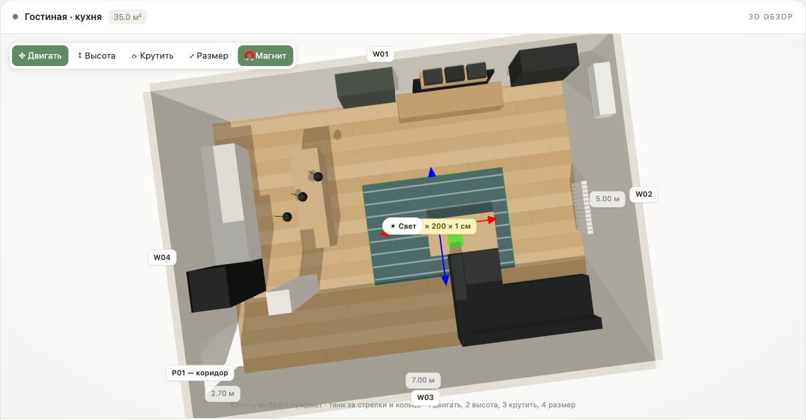
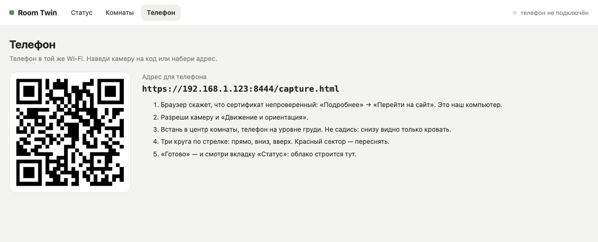
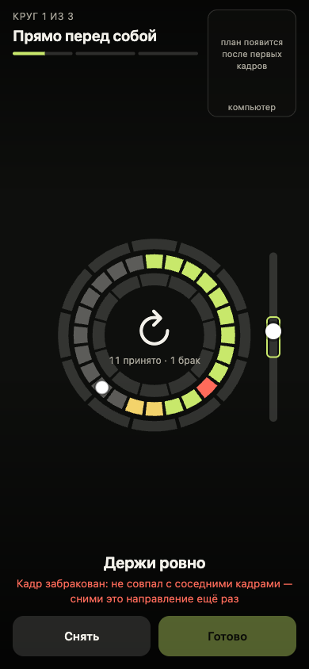

# Room Twin — цифровой двойник дома по камере телефона

Встаёшь в центр комнаты, телефон в руке, поворачиваешься по стрелкам. Компьютер на лету
считает глубину, строит облако точек и план в метрах. Потом агент (Claude Code, Codex) расставляет
по облаку и кадрам мебель, двери и окна, а ты дорабатываешь комнату в 3D-редакторе в духе
режима строительства The Sims: двигаешь, крутишь, меняешь размеры, отмечаешь розетки и
электроприборы, двигаешь стены.



- Телефон — **только камера в браузере** (iPhone/Android, без приложения). Всё тяжёлое — на компьютере.
- Глубина — **Depth Anything V2 Metric Indoor** локально в ONNX, метры без LiDAR.
- Комнату собирает **агент**, а не облачная модель «по фото»: метры дают глубина и гироскоп,
  смысл (что это за предмет) — агент по кадрам.
- Всё упаковано как **скилл** для агентов: [`SKILL.md`](SKILL.md) (Claude Code) и [`AGENTS.md`](AGENTS.md) (Codex и др.).

## Как это устроено

```
 компьютер: scripts/serve_capture.py  ── https в локальной сети ──  телефон: web/capture.html
     │                                                                 камера + гироскоп,
     │  ◄── каждый кадр сразу, с направлением камеры ──────────────     стрелки «куда повернуться»,
     │                                                                 3 круга: прямо / вниз / вверх
     ├─ scripts/live.py   глубина кадра (≈0.3 с), брак, живой план и облако
     │       └─► главная страница  https://localhost:8443/  (Статус · Комнаты · Телефон)
     │
     ├─ «Готово» → scripts/cloud.py
     │       уточнение курса и масштаба кадров по совпадению стен, облако, прямоугольник комнаты,
     │       plan_room.png, poses.json, cloud.ply, cloud.html
     │
     ├─ агент: sheet.py + heightmap.py → смотрит план, карту высот и кадры → room.json
     │
     └─ web/viewer.html  room.json → 3D-редактор, сохранение обратно в room.json
```

Почему не LiDAR: из браузера на iPhone он недоступен — Safari не поддерживает WebXR, а Chrome на iOS
работает на том же движке. Глубина считается нейросетью по обычной камере, точность — 10–20 см.

## Установка

Нужны macOS / Linux, Python 3.10+, [`uv`](https://docs.astral.sh/uv/) и телефон в той же Wi-Fi.

```bash
git clone https://github.com/vakovalskii/room-twin && cd room-twin

# модель глубины — один раз (скачает официальный чекпоинт с Hugging Face и сконвертирует в ONNX, 99 МБ)
uv run --python 3.12 --with torch --with transformers --with onnx --with onnxruntime \
  python tools/export_depth.py models/da2-metric-indoor-small.onnx

# проверка геометрии на синтетической комнате
uv run --with numpy python tools/selftest_geometry.py
```

## Пошагово

### 1. Запустить сервер и открыть главную

```bash
uv run --with numpy --with onnxruntime --with pillow python scripts/serve_capture.py
# Открой на телефоне: https://192.168.x.x:8443/capture.html
# На компьютере: https://localhost:8443/  (статус, комнаты, редактор)
```

Открой `https://localhost:8443/` на компьютере. Браузер предупредит о сертификате — он самоподписанный,
выписан на IP твоего компьютера: «Подробнее» → «Перейти на сайт».

Вкладка **Телефон** — QR и адрес:



### 2. Снять комнату

На телефоне: открыть адрес, принять сертификат, разрешить камеру и «Движение и ориентация».

- Встань **в центр комнаты** и не сходи с места — только поворачивайся. Не садись: снизу видна одна кровать.
- Телефон вертикально, на уровне груди, камерой от себя. Себя и людей в кадр не бери.
- **Три круга**: прямо (кадр каждые 15°), с наклоном вниз — пол и мебель, вверх — верх стен.
- Стрелка в центре говорит, куда повернуться, шкала справа — как наклонить. Кадр снимается сам,
  когда телефон замер.
- Сектор: жёлтый — компьютер считает, зелёный — принят, красный — брак (смазано или не совпал
  со стенами соседних кадров: человек, предмет вплотную). Стрелка сама приведёт переснять.
- Темно — кнопка «Фонарик» (если камера его отдаёт). В углу — живой план с компьютера.



Пока снимаешь, на вкладке **Статус** на компьютере растёт 3D-облако, видны все кадры с браком
и план. По «Готово» компьютер выравнивает кадры и собирает облако (≈10 с).

### 3. Собрать комнату — агентом

Скажи агенту (Claude Code с этим скиллом, Codex с `AGENTS.md`): «собери комнату по последнему скану».
Он следит за съёмкой (`scripts/watch.py`), а после «Готово»:

```bash
python scripts/sheet.py out/<id>        # лист кадров: номер, стена, наклон, брак
python scripts/heightmap.py out/<id>    # карта высот сверху: кровать, столы, шкафы
# агент смотрит plan_room.png, height.png, sheet.jpg и пишет out/<id>/room.json
python scripts/render_html.py out/<id>/room.json
```

Без агента: `scripts/build_room.py` размечает предметы vision-моделью через
[NeuralDeep Hub](https://hub.neuraldeep.ru) (`NEURALDEEP_API_KEY`), но заметно хуже.

### 4. Доработать в редакторе

**Комнаты** → **Редактор**.

| что | как |
|---|---|
| выбрать | клик по предмету, двери/окну или стене; справа — все свойства, размеры в сантиметрах |
| двигать по полу | `1` или «Двигать», тянуть за стрелки (шаг 5 см) или за сам предмет |
| поднять / опустить | `2` или «Высота» |
| крутить | `3` или «Крутить» — кольцо, шаг 15°; `R` +45°, `⇧R` +15° |
| размер | `4` или «Размер» — ручки ширины, глубины, высоты; или поля в см |
| магнит к стенам | `M` — мебель прилипает к стене, только если отпустить вплотную |
| размер комнаты | клик по стене → стрелка; зелёный «призрак» показывает, куда встанет стена; что стоит к ней вплотную — едет с ней |
| двери, окна, арки | «Добавить» → тащить по стене, ширина/высота/от пола, угол открытия двери |
| электрика | розетки, выключатели, свет, ТВ, ПК, кондиционер, холодильник, стиральная машина…; галочка ⚡ и мощность у любого предмета; сумма — в панели вида |
| комната | размеры, цвет стен, пол (паркет, тёмный дуб, плитка, ковролин, бетон), «Выровнять всё по полу и стенам» |
| сохранить | `⌘S` / «Сохранить» — пишет `room.json` и пересобирает `room.html`; без сервера — «Скачать room.json» |

Также: `Delete` — удалить, стрелки — сдвиг на 5 см, `Esc` — снять выбор, «Сверху» — план.

## Что лежит в `out/<id>/`

| файл | что |
|---|---|
| `frames/`, `depth/` | кадры и кеш глубины (float16) |
| `cloud.ply` | облако точек в координатах комнаты — открывается в MeshLab, Blender, CloudCompare |
| `cloud.html` | облако в браузере, срез по высоте |
| `plan_room.png` | план сверху в метрах: стены, следы мебели, лучи кадров |
| `height.png` | карта высот для расстановки мебели |
| `sheet.jpg` | все кадры с номерами и стенами |
| `poses.json` | размер комнаты, разброс стен, курс и масштаб каждого кадра |
| `room.json` / `room.html` | модель комнаты и редактор (данные вшиты, открывается и без сервера) |

## Формат `room.json`

```jsonc
{
  "format": "room-twin/1",
  "name": "Спальня",
  "size": { "width": 5.28, "depth": 5.23, "height": 2.7 },   // метры; x — вдоль стены S, y — вдоль W
  "wall_color": "#ede9e0", "floor": "planks",
  "objects": [
    { "id": "O01", "category": "bed", "name": "Кровать", "color": "#8e9296",
      "mount": "floor",            // floor | wall | ceiling
      "x": 2.1, "y": 1.05,         // центр, м
      "w": 1.6, "d": 2.05, "h": 0.95, "elevation": 0,
      "wall": "S",                 // к какой стене спиной (N, E, S, W)
      "rot": 45,                   // необязательно: свободный поворот, градусы
      "electric": false, "power_w": 0, "note": "" }
  ],
  "openings": [
    { "id": "P01", "type": "door", "wall": "E", "x": 5.28, "y": 1.25, "w": 0.85, "h": 2.05, "elevation": 0, "open": 25 }
  ]
}
```

## Файлы проекта

| файл | что |
|---|---|
| `SKILL.md`, `AGENTS.md` | инструкции для агентов: флоу, команды, формат |
| `web/capture.html` | съёмка на телефоне |
| `web/index.html` | главная на компьютере: статус с живым облаком, комнаты, телефон с QR |
| `web/viewer.html` | 3D-редактор комнаты (three.js) |
| `web/cloud.html` | просмотр облака точек |
| `scripts/serve_capture.py` | https-сервер: страницы, приём кадров, сохранение из редактора, API статуса |
| `scripts/live.py` | живая обработка кадров: глубина, брак, план, облако |
| `scripts/cloud.py` | финальное облако: выравнивание кадров, комната, план, PLY |
| `scripts/watch.py` | агент следит за съёмкой, выходит при готовом облаке |
| `scripts/sheet.py`, `scripts/heightmap.py` | лист кадров и карта высот для агента |
| `scripts/render_html.py` | `room.json` → `room.html` |
| `scripts/build_room.py` | запасной автосборщик через vision-модель |
| `tools/export_depth.py` | официальная модель глубины → ONNX |
| `tools/selftest_geometry.py` | проверка геометрии на синтетике |

## Скорость (MacBook, CPU)

| этап | время |
|---|---|
| глубина одного кадра 518 px | ≈ 0.27 с (CoreML в onnxruntime медленнее — 0.44 с, модель дробится) |
| живая обработка кадра целиком | ≈ 0.3–0.4 с, телефон не ждёт |
| финальное облако, 30 кадров, глубина в кеше | ≈ 7 с |

## Ограничения

- Точность 10–20 см: глубина с одной камеры.
- Комната — прямоугольник; скан из одной точки, за шкафом не видно.
- Пока одна комната на скан. Дальше — дом из нескольких комнат на общем плане и рисование стен.
- Сертификат самоподписанный: камера и гироскоп в браузере работают только по https.

## Тесты без телефона

```bash
ROOM_TWIN_HTTP=1 uv run --with numpy --with onnxruntime --with pillow python scripts/serve_capture.py 8444
```

Сервер без TLS для браузерных автотестов (Playwright). Готовый скан из `captures/*.json` можно
«проиграть» в `/live/start`, `/live/<id>/frame`, `/live/<id>/finish`. В редакторе для тестов есть
`window.roomEditor` (`pick`, `screen`, `room`, `gizmo`).
