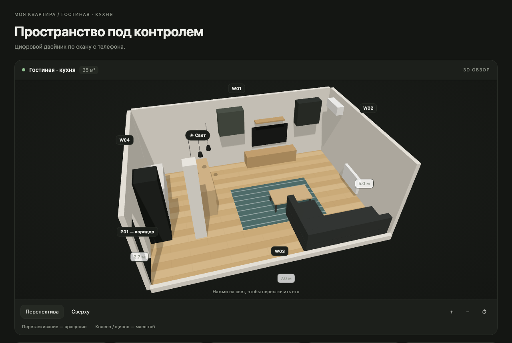

# Room Twin — цифровой двойник комнаты по скану с телефона

Встаёшь в центр комнаты с телефоном, медленно поворачиваешься — и получаешь 3D-план:
размеры в метрах, стены с дверями и окнами, мебель, светильники, которые можно включать.



## Как это работает

```
iPhone, браузер (web/capture.html)
  камера + гироскоп → кадр каждые 15° поворота с направлением камеры
        │  room-capture.json  (сразу на компьютер через scripts/serve_capture.py)
        ▼
scripts/build_room.py
  ├─ Depth Anything V2 Metric Indoor (ONNX, локально) → глубина каждого кадра в метрах
  ├─ кадр + направление → точки комнаты → дальние точки = стены → прямоугольник комнаты
  ├─ vision-модель NeuralDeep (qwen3.6-fp8) → предметы и проёмы рамками на кадрах
  └─ рамка + глубина под ней + направление камеры → место и размер предмета на плане
        ▼
room.json (модель комнаты) + room.html (3D-вьюер на three.js)
```

Почему так, а не «VLM по фото»: vision-модель хорошо понимает, *что* в кадре, но выдумывает,
*где* и *какого размера*. Метры даёт метрическая модель глубины, направление — гироскоп,
а VLM отвечает за смысл: диван это или тумба, какого цвета, светильник ли.

Почему не LiDAR: из браузера на iPhone LiDAR недоступен (Safari не поддерживает WebXR,
Chrome на iOS работает на том же WebKit). Глубина считается нейросетью по обычной камере.

## Быстрый старт

```bash
git clone <репо> && cd room-twin
# 1. модель глубины (один раз, 99 МБ)
uv run --python 3.12 --with torch --with transformers --with onnx --with onnxruntime \
  python tools/export_depth.py models/da2-metric-indoor-small.onnx
# 2. ключ NeuralDeep Hub
export NEURALDEEP_API_KEY=sk-...
# 3. съёмка: открыть на телефоне ссылку, которую напечатает сервер
python scripts/serve_capture.py
# 4. сборка
uv run --with numpy --with onnxruntime --with pillow \
  python scripts/build_room.py captures/room-capture-*.json --out out/room
open out/room/room.html
```

## Файлы

| файл | что |
|---|---|
| `web/capture.html` | съёмка на телефоне: камера, гироскоп, кольцо снятых направлений, отправка |
| `scripts/serve_capture.py` | https-сервер в локальной сети: отдаёт страницу, принимает скан в `captures/` |
| `scripts/build_room.py` | скан → `room.json` + `room.html` |
| `scripts/render_html.py` | пересобрать `room.html` после ручной правки `room.json` |
| `web/viewer.html` | 3D-вьюер (three.js), данные вшиваются в файл |
| `tools/export_depth.py` | официальная модель глубины → ONNX |
| `tools/selftest_geometry.py` | проверка геометрии на синтетической комнате |
| `samples/room.sample.json` | пример модели комнаты для вьюера |

## Формат `room.json`

```jsonc
{
  "name": "Гостиная · кухня",
  "size": { "width": 7.0, "depth": 5.0, "height": 2.7 },   // метры; x — ширина, y — глубина
  "fit_error_m": 0.08,                                      // разброс точек стен вокруг прямоугольника
  "objects": [{
    "id": "O01", "category": "sofa_corner", "name": "Угловой диван", "color": "#2f3330",
    "material": "ткань", "mount": "floor", "is_light": false,
    "x": 5.6, "y": 1.0,              // центр на плане от угла (0, 0)
    "w": 2.6, "d": 1.7, "h": 0.82,   // ширина, глубина, высота
    "elevation": 0, "wall": "S",     // ближайшая стена: N / E / S / W, спинкой к ней
    "views": 3                       // на скольких кадрах найден
  }],
  "openings": [{ "id": "P01", "type": "door", "leads_to": "коридор", "wall": "W",
                 "x": 0.0, "y": 0.6, "w": 0.9, "h": 2.1, "elevation": 0 }]
}
```

## Ограничения

- Точность — десятки сантиметров. Высоту потолка лучше ввести при съёмке.
- Комната сводится к прямоугольнику.
- Скан из одной точки: за крупной мебелью не видно.
- Разметка — vision-запрос на кадр (≈ 20 с, 4 параллельно), оплачивается с кошелька Hub.
- Угол обзора камеры не читается из браузера: по умолчанию iPhone 1x (`--hfov 69`).

## Лицензия

MIT для кода. У модели глубины своя лицензия: см. карточку
[Depth-Anything-V2-Metric-Indoor-Small-hf](https://huggingface.co/depth-anything/Depth-Anything-V2-Metric-Indoor-Small-hf)
и репозиторий Depth Anything V2.
